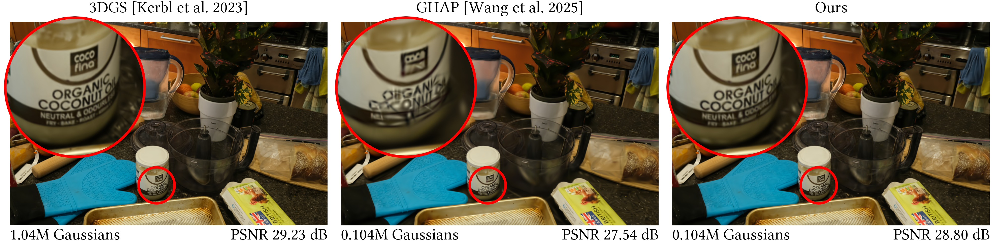

# Metric-Aware 3DGS Pruning via Differentiable Parameter Editing

Gwangjin Ju, Wonjong Jang, Gahye Lee, Yoonha Hwang, Seungyong Lee<br>
POSTECH · SIGGRAPH Asia 2026

[Paper (not available yet)](https://doi.org/10.1145/3829340.3842263) | [Code](https://github.com/jugwangjin/metric-aware-pruning)



This repository contains the implementation of **Metric-Aware 3DGS Pruning via Differentiable Parameter Editing**.

This code is built upon [PUP 3D-GS](https://github.com/j-alex-hanson/gaussian-splatting-pup/tree/main).

**Abstract:** High-fidelity 3D Gaussian Splatting (3DGS) often relies on a large number of Gaussian primitives, making pruning essential for reducing storage and rendering costs while preserving reconstruction quality.  We propose a visual quality metric-aware pruning method that transforms the combinatorial pruning problem into a differentiable 3DGS parameter editing task. Instead of treating each pruning candidate as a discrete scene modification, we represent it as a continuous displacement vector in the 3DGS parameter space. This formulation allows us to define a metric-aware pruning score that analytically approximates the visual quality change induced by each parameter edit. Our pruning score can incorporate any visual quality metric, ranging from pixel-level differences to neural network-based perceptual metrics, provided that the metric is differentiable. To make the score computationally tractable, we employ Jacobian sketching, which stochastically approximates the full high-dimensional Jacobian by reducing the dimensionality through random projections. Experiments on 3DGS benchmarks show that our method better preserves PSNR and perceptual quality under aggressive pruning. The versatility of our framework is further demonstrated by diverse pruning results tailored to different visual quality metrics.

## Setup

Follow the installation instructions for [3D Gaussian Splatting](https://github.com/graphdeco-inria/gaussian-splatting#installation). For CLIP-guided pruning, also install [OpenAI CLIP](https://github.com/openai/CLIP#usage).

Then clone this repository and install its two CUDA submodules in the same environment:

```bash
git clone --recursive https://github.com/jugwangjin/metric-aware-pruning.git
cd metric-aware-pruning
python -m pip install --no-build-isolation \
  ./submodules/diff-gaussian-rasterization ./submodules/simple-knn
```

## Running

### Full Pruning Pipeline

First, train a 3DGS model for 30K iterations with `train.py`:

```bash
python train.py \
  -s /path/to/dataset/garden -r 4 --eval \
  -m output/garden \
  --iterations 30000
```

Then load the saved PLY into `prune_finetune.py` to prune and finetune:

```bash
python prune_finetune.py \
  -s /path/to/dataset/garden -r 4 --eval \
  -m output/garden_mse \
  --start_pointcloud output/garden/point_cloud/iteration_30000/point_cloud.ply \
  --first_iter 30000 --iterations 40000 --position_lr_max_steps 35000 \
  --prune_iterations 30001 35001 --prune_percent 0.8 0.5 \
  --score_metric mse
```

Use the same image folder and resolution for training, pruning and rendering; for example, `-r 4` for an outdoor Mip-NeRF 360 scene or `-r 1` for Train. An existing 30K-iteration model can also be supplied with `--start_pointcloud`.

The default pipeline:

1. Removes 80% of the Gaussians and finetunes for 5K iterations.
2. Removes 50% of the remaining Gaussians and finetunes for another 5K iterations.
3. Saves the final model under `output/garden_mse/point_cloud/iteration_40000/`.

This retains approximately 10% of the original Gaussians. For approximately 5% retention, use `--prune_percent 0.8 0.75`. Render and evaluate the final model using the commands below.

### Pruning Objectives

Select the objective with `--score_metric` in `prune_finetune.py`:

| Objective | Flag | Feature residual |
|---|---|---|
| MSE | `mse` | Rendered RGB minus GT RGB |
| VGG perceptual | `lpips` | LPIPS-weighted VGG feature differences |
| SSIM | `ssim` | Unaggregated `1 - SSIM(render, GT)` map |
| CLIP | `clip` | Patch–text margin(render) minus margin(GT) |

For LPIPS or SSIM pruning, replace `--score_metric mse` in the command above with `--score_metric lpips` or `--score_metric ssim` and choose a corresponding output directory with `-m`.

All objectives use the same signed metric-aware score and `torch.autograd.grad` VJPs. Defaults are 64 normalized Rademacher probes, target opacity `1e-4`, and log-scale displacement `-3`. Opacity edits use activated-opacity space. Gaussians with the lowest scores are pruned.

Use `--start_checkpoint` instead of `--start_pointcloud` for a compatible PUP checkpoint. When loading a PLY from a custom directory, pass its starting iteration explicitly with `--first_iter`.

### CLIP-Guided Pruning on Train

The main-paper CLIP example uses CLIP ViT-B/32 patch–text margins to preserve Train-related regions. Compare it with MSE pruning at the same Gaussian budget, immediately after pruning and without finetuning:

```bash
python train.py \
  -s /path/to/dataset/Train -r 1 --eval \
  -m output/Train --iterations 30000

python prune_finetune.py \
  -s /path/to/dataset/Train -r 1 --eval \
  -m output/Train_clip \
  --start_pointcloud output/Train/point_cloud/iteration_30000/point_cloud.ply \
  --first_iter 30000 --iterations 30001 \
  --prune_iterations 30001 --prune_percent 0.9 \
  --score_metric clip --prune_only
```

The pruning command removes 90% of the input Gaussians. For the MSE comparison, repeat it with `--score_metric mse` and `-m output/Train_mse`. Change `--prune_percent` to use another removal fraction. Pretrained CLIP and VGG weights are downloaded on first use when they are not already cached.

### Rendering and Evaluation

```bash
python render.py -s /path/to/dataset/garden -r 4 -m output/garden_mse \
  --iteration 40000 --skip_train
python metrics.py --model_paths output/garden_mse
```

Image quality metrics are saved to `output/garden_mse/results.json`. For the CLIP example, use the Train dataset, `-r 1`, `-m output/Train_clip` and `--iteration 30001` instead.

## BibTeX

If you use this implementation, please cite our paper:

```bibtex
@inproceedings{ju2026metricaware,
  title={Metric-Aware 3DGS Pruning via Differentiable Parameter Editing},
  author={Ju, Gwangjin and Jang, Wonjong and Lee, Gahye and Hwang, Yoonha and Lee, Seungyong},
  booktitle={Proceedings of the SIGGRAPH Asia 2026 Conference Papers},
  pages={1--11},
  year={2026}
}
```

## License

See [LICENSE.md](LICENSE.md) and the notices in the corresponding source files and submodules for usage terms.
